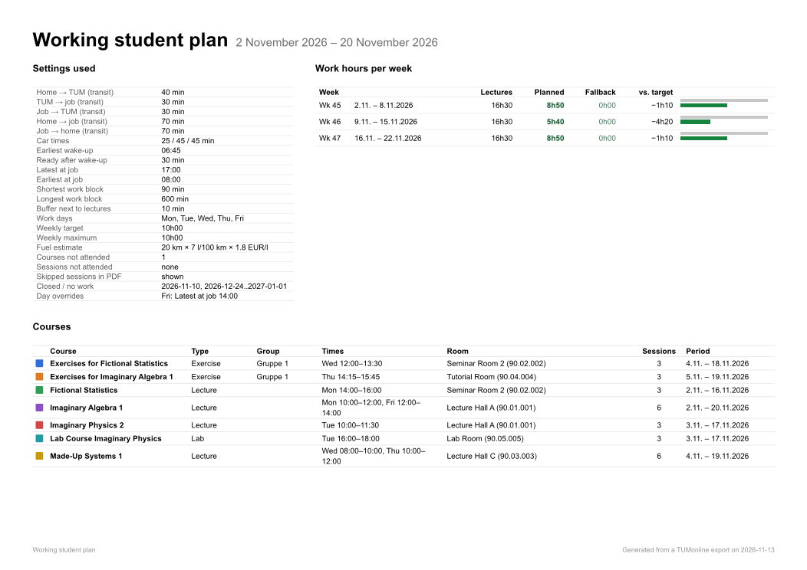
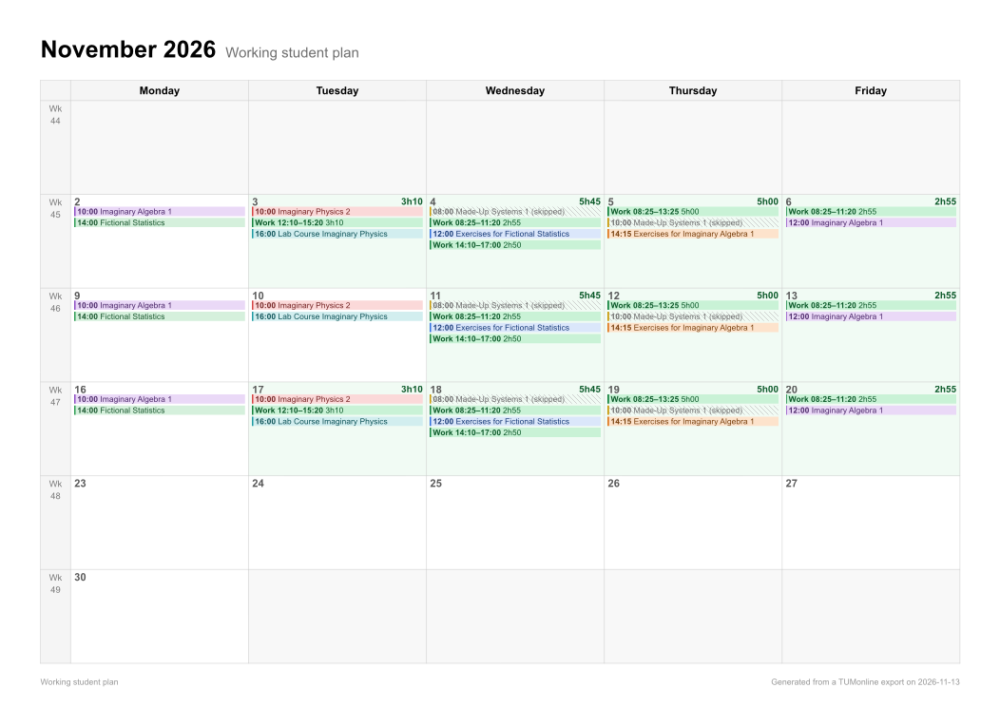

# working-student-planner

Tells you **when you can work at your working-student job**, given your TUM lecture timetable
and your travel times, and renders the result as a printable PDF calendar built with
[Typst](https://typst.app).

For every week and every work day the planner finds the time windows in which you can be at the
job: between your lectures (after the travel to the job and back to TUM), before the first lecture
(after getting up) and after the last one (until you have to leave). Windows shorter than your minimum
work block are dropped.

The PDF contains

- an **overview**: the settings used, the courses with a colour legend (skipped ones marked), and the
  possible work hours per week against your target,
- one **month grid** per month with the possible work hours per day,
- one **week timetable** per week: lectures in their course colour, travel in grey, and the
  **possible work slots in green** with start, end and duration.

| Overview | Month | Week |
| --- | --- | --- |
|  |  |  |

The previews are generated from the fictional data in [`examples/example.csv`](examples/example.csv)
with [`config.example.toml`](config.example.toml). The week preview shows a work slot between two lectures.

## Requirements

- [Typst](https://github.com/typst/typst#installation) 0.13 or newer
- Python 3.11 or newer (standard library only, nothing to install; `tomllib` is used for the config)

## 1. Export your calendar from TUMonline

1. Log in to [TUMonline](https://campus.tum.de).
2. Open **Personal calendar** (Persönlicher Kalender).
3. Click **Export**.
4. Choose **Download as CSV UTF-8**.

The export must be in German (columns `WOCHENTAG;DATUM;VON;BIS;…`), which is TUMonline's default.
Only the sessions in the export count as attended, so export the calendar that contains exactly
the sessions you attend (for example your own exercise group).

## 2. Configure your times

```sh
cp config.example.toml config.toml
```

Edit `config.toml`. It is git-ignored, because it contains your commute. Durations are whole
minutes; clock times are quoted `"HH:MM"`. Unknown keys are reported as errors, so typos do not go unnoticed.

| Key | Required | Default | Meaning |
| --- | --- | --- | --- |
| `[travel] home_to_tum` | yes | | Home → TUM, minutes |
| `[travel] tum_to_job` | yes | | TUM → job, minutes |
| `[travel] job_to_tum` | no | `tum_to_job` | Job → TUM, minutes |
| `[travel] home_to_job` | no | `home_to_tum + tum_to_job` | Home → job directly; used before the first lecture |
| `[travel] job_to_home` | no | `home_to_job` | Job → home; only used to draw the last travel block of a day |
| `[schedule] earliest_wake_up` | yes | | Earliest time you get up, `"HH:MM"` |
| `[schedule] latest_at_job` | yes | | Latest time you may still be at the job, `"HH:MM"` (not a duration) |
| `[schedule] min_time_at_company` | yes | | Shortest work block worth going to the job for, minutes |
| `[schedule] ready_minutes` | no | `0` | Time between getting up and leaving home |
| `[schedule] earliest_at_job` | no | none | Office opens; no work before this, `"HH:MM"` |
| `[schedule] max_shift_minutes` | no | none | Longest single work block, minutes |
| `[schedule] buffer_minutes` | no | `0` | Extra minutes kept free on each side of a work block that touches a lecture |
| `[schedule] work_days` | no | Mon–Fri | Weekdays you can work: `["mon", "tue", …]` |
| `[schedule] weekly_target_hours` | no | none | Your planned hours per week; the overview shows surplus or deficit |
| `[lectures] not_attended` | no | `[]` | `LV_NUMMER` values to ignore completely (leading zeros do not matter) |
| `[lectures] sessions_not_attended` | no | `[]` | Only some session types, as `"LV_NUMMER:LV_ART"`, e.g. `"0000000104:UE"` |
| `[lectures] show_skipped` | no | `true` | `true` draws skipped sessions hatched and labelled "skipped"; `false` hides them |
| `[holidays] no_work` | no | `[]` | Dates or ranges without work: `"2026-12-24"` or `"2026-12-24..2027-01-06"` |
| `[day_overrides.<weekday>]` | no | | `latest_at_job` and/or `earliest_at_job` for one weekday, e.g. `[day_overrides.fri]` |

Skipped sessions are ignored for the work slots: they do not block time, and the slot is computed as
if they did not exist. In the PDF they are drawn as a hatched strip next to the work slot.

## 3. Build the PDF

```sh
# 1. compute the work slots: writes data/plan.json and prints a summary
python -I scripts/plan.py path/to/personal_YYYYMMDD_HHMMSS.csv --config config.toml

# 2. render the PDF
typst compile calendar.typ plan.pdf
```

Try it out with the fictional example first:

```sh
python -I scripts/plan.py examples/example.csv --config config.example.toml -o data/example.json
typst compile calendar.typ example.pdf --input data=data/example.json
```

The summary lists, per week, the possible hours and the work slots per work day, for example:

```
KW 45  02.11.-08.11.2026   possible work 16h50   (target 10h00: +6h50)
  Tue 03.11.  12:10-15:20 (3h10)
  Wed 04.11.  08:25-11:20 (2h55), 14:10-17:00 (2h50)
```

### Options

Pass options to Typst with `--input key=value`:

| Key | Default | Description |
| --- | --- | --- |
| `data` | `data/plan.json` | JSON file from `plan.py`. Must be inside this project folder |
| `title` | `Working student plan` | Title shown on every page |
| `lang` | `en` | `en` or `de` (labels, month and weekday names) |
| `views` | `overview,month,week` | Comma-separated subset of pages to include |
| `empty-weeks` | `false` | `true` also prints weeks without lectures or work slots |

Example: German, weekly pages only:

```sh
typst compile calendar.typ plan.pdf --input lang=de --input views=week
```

## How the slots are computed

For each day in the range of the export (from the Monday of the first session to the Sunday of the last):

- If the day is not a work day or lies in `no_work`, there is no slot.
- Only the attended sessions count. Overlapping or touching sessions are merged into one block.
- **Morning:** from `earliest_wake_up + ready_minutes + home_to_job` (or the `earliest_at_job`, if later)
  until the first lecture minus `job_to_tum` and `buffer_minutes`.
- **Between two lectures:** from the end of the earlier one plus `tum_to_job` and the buffer, until the
  start of the next one minus `job_to_tum` and the buffer.
- **Evening:** from the end of the last lecture plus `tum_to_job` and the buffer, until `latest_at_job`.
- **No lectures that day:** one slot from the earliest arrival (`earliest_wake_up + ready + home_to_job`) until `latest_at_job`.
- Every slot is clipped to `earliest_at_job`, `latest_at_job` (per weekday if overridden) and `max_shift_minutes`.
  Slots shorter than `min_time_at_company` are dropped.

Assumptions:

- Days without any session in the export count as free days. Holidays, exam periods and vacations
  must be listed in `no_work`, otherwise they show as full work days.
- The travel times are the same on every day; there is no timetable for public transport.
- Travel times are applied as one block each way. Walking between two buildings at TUM is not modelled.

## Privacy

Your export and your `config.toml` describe your personal timetable and commute. The `.gitignore`
excludes all CSV files, `config.toml`, the `data/` folder and all PDF and PNG files, except the
fictional files in `examples/`. Check with `git status --ignored` before you publish.

## Tests

```sh
python -I -m unittest discover -s tests -v
```

The tests cover the slot rules (boundaries, lectures at 08:00, lectures past the latest time,
overlaps, buffers, overrides, holidays), the config validation, the lane layout and an end-to-end run.
