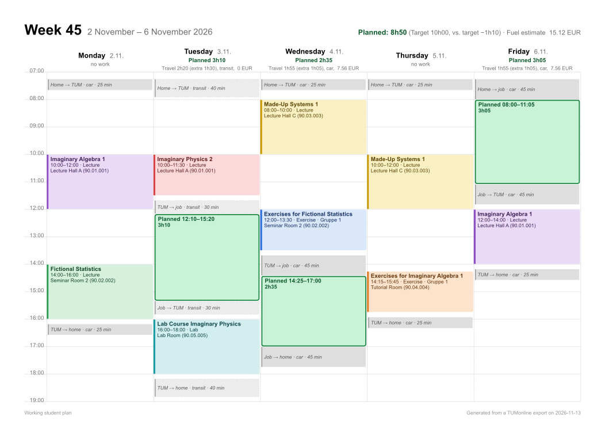

# working-student-planner

Tells you **when and how to get to your working-student job**, given your TUM lecture timetable,
your travel times and your car, and renders the result as a printable PDF calendar built with
[Typst](https://typst.app).

For every week the planner chooses the work days that reach your target hours (for example 20 h)
at the lowest travel cost. For every day it works out the best way to travel: by car or by transit,
and whether it is worth going to the job at all. The PDF shows the choice as a calendar.

The PDF contains

- an **overview**: the settings used, the courses with a colour legend (skipped ones marked), and
  the planned and fallback hours per week against your target,
- one **month grid** per month with the planned work hours per day,
- one **week timetable** per week: lectures in their course colour, travel blocks (car solid,
  transit dotted), **planned work in dark green** and **fallback work in a lighter green**, each
  with start, end and duration, and each day's evaluation in its header.

| Overview | Month | Week |
| --- | --- | --- |
|  |  |  |

The previews are generated from the fictional data in [`examples/example.csv`](examples/example.csv)
with [`config.example.toml`](config.example.toml). The week preview shows planned work (dark green)
and a fallback day (light green), a car commute and transit commute.

## Requirements

- [Typst](https://github.com/typst/typst#installation) 0.13 or newer
- Python 3.11 or newer (standard library only, nothing to install)

## 1. Export your calendar from TUMonline

1. Log in to [TUMonline](https://campus.tum.de).
2. Open **Personal calendar** (Persönlicher Kalender).
3. Click **Export**.
4. Choose **Download as CSV UTF-8**.

The export must be in German (columns `WOCHENTAG;DATUM;VON;BIS;…`), which is TUMonline's default.
Only the sessions in the export count as attended, so export the calendar that contains exactly
the sessions you attend (for example your own exercise group).

## 2. Configure your times

```sh
cp config.example.toml config.toml
```

Edit `config.toml`. It is git-ignored, because it contains your commute. Durations are whole
minutes; clock times are quoted `"HH:MM"`. Unknown keys are reported as errors, so typos do not go unnoticed.

| Key | Required | Default | Meaning |
| --- | --- | --- | --- |
| `[travel] home_to_tum` | yes | | Home → TUM by transit, minutes |
| `[travel] tum_to_job` | yes | | TUM → job by transit, minutes |
| `[travel] job_to_tum` | no | `tum_to_job` | Job → TUM by transit |
| `[travel] home_to_job` | no | `home_to_tum + tum_to_job` | Home → job by transit |
| `[travel] job_to_home` | no | `home_to_job` | Job → home by transit |
| `[car] home_to_tum`, `home_to_job`, `tum_to_job` | yes, if `[car]` exists | | Car times, minutes |
| `[car] job_to_tum`, `job_to_home`, `tum_to_home` | no | the other direction | Car times in the other direction |
| `[car] distance_in_km`, `liters_per_100km`, `fuel_price_per_liter` | no (all three or none) | none | Fuel estimate: every car leg drives `distance_in_km` |
| `[schedule] earliest_wake_up` | yes | | Earliest time you get up, `"HH:MM"` |
| `[schedule] latest_at_job` | yes | | Latest time you may still be at the job, `"HH:MM"` (not a duration) |
| `[schedule] min_time_at_company` | yes | | Shortest visit to the job worth going for, minutes; the visit includes the break |
| `[schedule] break_minutes` | no | `0` | Unpaid break taken inside each visit, minutes. Work time = visit − break |
| `[schedule] weekly_target_hours` | no | none | Hours the planner fills up to each week, e.g. `20` |
| `[schedule] max_hours_per_week` | no | the target | Never planned above this per week |
| `[schedule] ready_minutes` | no | `0` | Time between getting up and leaving home |
| `[schedule] earliest_at_job` | no | none | Office opens; no work before this, `"HH:MM"` |
| `[schedule] max_shift_minutes` | no | none | Longest single *work* time, minutes. The visit may be this plus the break |
| `[schedule] buffer_minutes` | no | `0` | Extra minutes kept free on each side of a visit that touches a lecture |
| `[schedule] work_days` | no | Mon–Fri | Weekdays you can work: `["mon", "tue", …]` |
| `[lectures] not_attended` | no | `[]` | `LV_NUMMER` values to ignore completely (leading zeros do not matter) |
| `[lectures] sessions_not_attended` | no | `[]` | Only some session types, as `"LV_NUMMER:LV_ART"`, e.g. `"0000000104:UE"` |
| `[lectures] show_skipped` | no | `true` | `true` draws skipped sessions hatched and labelled "skipped"; `false` hides them |
| `[holidays] no_work` | no | `[]` | Dates or ranges without work: `"2026-12-24"` or `"2026-12-24..2027-01-06"` |
| `[holidays] no_work_durations` | no | `[]` | Timed blocker on one day, `"2026-12-15 10:00..10:30"` (e.g. an exam). No work that day before the end time; work after it is still planned |
| `[holidays] company_closed` | no | `[]` | Dates or ranges when the company is closed. Lectures still happen; no work is planned. Merged with `no_work` |
| `[calendar] start`, `end` | no | export range | First and last day of the planned and drawn calendar, e.g. `"2026-12-01"` and `"2027-02-05"`. Days outside it are shaded and not planned |
| `[day_overrides.<weekday>]` | no | | `latest_at_job` and/or `earliest_at_job` for one weekday, e.g. `[day_overrides.fri]` |

Skipped sessions are ignored for the work visits: they do not block time, and a visit is computed
as if they did not exist. In the PDF they are drawn as a hatched strip next to the work.

### Without a car

Leave out the `[car]` section. All legs are then by transit, and the planner still chooses the days
for your target.

### The car

The car starts at home every morning. Taking it out of the house makes it stay with you until you are
home again, so you can take the car at the start of the day, or drive to TUM and then on to the job,
or take transit to TUM and go home for the car. The planner evaluates all of these routes and does not
let you leave the car behind (you cannot take the bus while the car is with you). Parking at TUM or at
the job is not modelled.

## 3. Build the PDF

```sh
# 1. plan the days: writes data/plan.json and prints a summary
python -I scripts/plan.py path/to/personal_YYYYMMDD_HHMMSS.csv --config config.toml

# 2. render the PDF
typst compile calendar.typ plan.pdf
```

Or do both in one step with `--compile`, which runs the Typst command afterwards (the JSON must be inside the project folder):

```sh
python -I scripts/plan.py path/to/personal_YYYYMMDD_HHMMSS.csv --config config.toml --compile
```

For your supervisor, add `--boss-csv` (optional path, default `data/office-hours.csv`). It writes a
semicolon-separated CSV that Excel opens with the columns already split: date, weekday, rough office
start (rounded to the half hour), work hours (the visit minus the unpaid break, rounded to the half hour) and
whether the day is an exam day (a day with a `no_work_durations` entry). It contains only planned days;
fallback days, lectures, the car and the fuel estimate are left out:

```sh
python -I scripts/plan.py path/to/personal_YYYYMMDD_HHMMSS.csv --config config.toml --boss-csv
```

`--boss-pdf` (optional path, default `data/office-hours.pdf`) writes the same monthly calendar as your
own PDF, but only the office blocks and the exam days. Lectures, course names, travel, fuel and the
week pages are left out. It compiles with Typst, so it needs `typst` on the PATH:

```sh
python -I scripts/plan.py path/to/personal_YYYYMMDD_HHMMSS.csv --config config.toml --boss-pdf
```

Both boss files use the same data (`"boss"` in `data/plan.json`), so they always agree.

Try it out with the fictional example first:

```sh
python -I scripts/plan.py examples/example.csv --config config.example.toml -o data/example.json
typst compile calendar.typ example.pdf --input data=data/example.json
```

The summary lists, for every week, the planned and fallback hours and each day's choice:

```
KW 45  02.11.-08.11.2026   planned 10h00, fallback 6h15   (target 10h00, deficit 0h00)
  Mon 02.11.  no work     commute 0h50 by car
  Tue 03.11.  FALLBACK 12:10-15:20 (3h10)  by transit, travel 2h20 (extra 1h30), cost 150
  Wed 04.11.  PLANNED  08:25-11:20 (2h55), 14:10-17:00 (2h50)  by transit, travel 3h20 (extra 2h30), cost 210
  Thu 05.11.  PLANNED  08:00-12:15 (4h15)  by car, travel 1h55 (extra 1h05), cost 125
```

### Options

Pass options to Typst with `--input key=value`:

| Key | Default | Description |
| --- | --- | --- |
| `data` | `data/plan.json` | JSON file from `plan.py`. Must be inside this project folder |
| `title` | `Working student plan` | Title shown on every page |
| `lang` | `en` | `en` or `de` (labels, month and weekday names) |
| `views` | `overview,month,week` | Comma-separated subset of pages to include |
| `empty-weeks` | `false` | `true` also prints weeks without lectures or work |

Example: German, weekly pages only:

```sh
typst compile calendar.typ plan.pdf --input lang=de --input views=week
```

## How the days are chosen

**Options of a day.** A day is split into stretches: from wake-up to the first lecture, between two
lectures, and from the last lecture to the evening. Each stretch is walked by every combination of
transit and car legs that is allowed (see *The car*), with at most one visit to the job per stretch.
A visit starts as early as the travel and the opening time allow, and ends as late as the next lecture
(minus the travel back) and `latest_at_job` allow.

**Cost.** The baseline of a day is the cheapest commute to TUM without work. An option's cost is its
extra travel: the travel of the whole day above that baseline. A visit adds its trips, so a day with work
costs more than a day without, and each extra company day adds its trips to the total. A day with lectures
and no work costs nothing. There is no flat penalty per company day.

**The week.** A small dynamic programme picks one option per day, and a visit length in 15-minute
steps, so that the planned hours reach `weekly_target_hours` at the lowest total travel without
exceeding `max_hours_per_week`. Because each company day adds trips, the choice prefers fewer, longer
visits. If the target cannot
be reached (for example because of holidays), the week shows the deficit.

**Planned and fallback.** Days chosen by the programme are *planned* (dark green). The next best days,
ranked by cost per work hour, are *fallback* (light green), enough to cover the target if planned days
fall through. The other days keep their cheapest commute and show their best option in the header.

**Evaluation.** Every day shows its travel, its extra travel over a commute without work, its mode of
transport and, for days with work, its cost. With a fuel estimate, each car day also shows the estimated
fuel in EUR: car legs × `distance_in_km` × `liters_per_100km` / 100 × `fuel_price_per_liter`. The fuel
estimate is shown, not optimised. The overview shows the planned hours per week against the target.

## Assumptions

- The export contains only the sessions you attend. Non-attended sessions are listed in the config.
- Days without any session in the export count as free days. Holidays, exam periods and vacations
  must be listed in `no_work` or `company_closed`, otherwise they show as full work days.
- Travel times are fixed per route; there is no timetable for public transport and no walking
  inside TUM. A walk between buildings at TUM is not modelled.
- The car is at home every morning, and every day ends at home.
- `distance_in_km` is one value for every car leg. A home-to-TUM leg and a TUM-to-job leg usually differ,
  so the fuel estimate is only approximate.
- Parking at TUM or at the job is not modelled.

## Privacy

Your export and your `config.toml` describe your personal timetable and commute. The `.gitignore`
excludes all CSV files, `config.toml`, the `data/` folder and all PDF and PNG files, except the
fictional files in `examples/`. Check with `git status --ignored` before you publish.

## Code layout

| Module | Job |
| --- | --- |
| `scripts/plan.py` | Command-line entry point (calls `planner/cli.py`) |
| `planner/cli.py` | Options, reading the export and the config, writing the outputs |
| `planner/tumonline.py`, `planner/events.py` | Reading the export; skipped sessions and lanes |
| `planner/config.py`, `config_parse.py`, `errors.py` | `config.toml` as typed settings, with validation |
| `planner/travel.py`, `timing.py` | Walks between places (car rules) and their clock times |
| `planner/days.py`, `weekly.py`, `planning.py` | Options of a day, the weekly choice, the plan |
| `planner/export.py`, `supervisor.py`, `summary.py`, `pdf.py` | JSON, supervisor CSV, terminal summary, Typst PDF |
| `calendar.typ` | Typst entry point: reads `data/plan.json`, options via `--input` |
| `template/build.typ` | Builds the pages (overview, months, weeks) for both PDFs |
| `template/overview.typ`, `month.typ`, `week.typ` | The three page types |
| `template/chips.typ`, `colors.typ`, `format.typ`, `data.typ` | Blocks, colours, dates and durations, JSON helpers |
| `template/language.typ`, `template/lang/*.typ` | Labels in English and German |

## Tests

```sh
python -I -m unittest -v
```

The tests live in `tests/`, one file per area (`test_walks.py`, `test_timing.py`, `test_days.py`,
`test_weekly.py`, `test_config.py`, `test_supervisor.py`, `test_pdf.py`, `test_end_to_end.py`).
They cover the walk rules for the car, the timing of visits (including shortening and minimum
length), the baseline and extra travel, the weekly choice (target reached with the fewest company days,
planned and fallback days never overlap, the maximum is never exceeded), the config validation, the lane
layout, the supervisor output and an end-to-end run.
